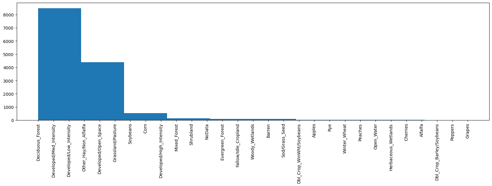
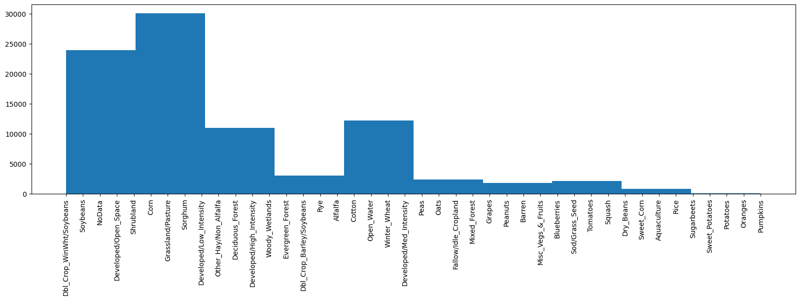
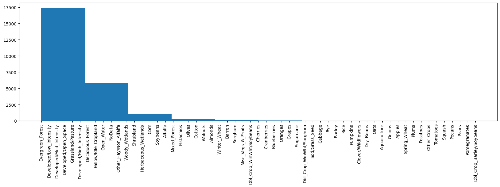
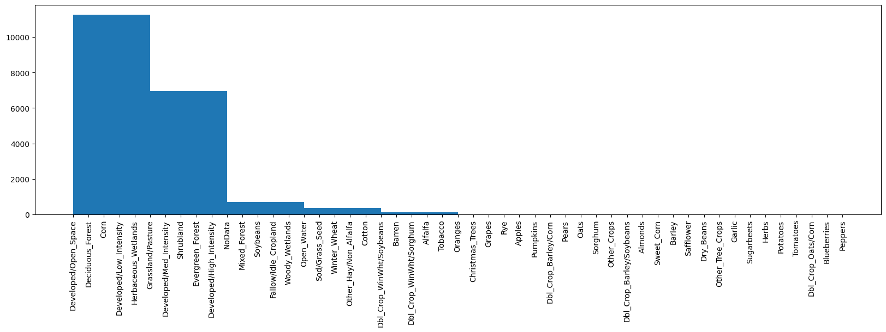
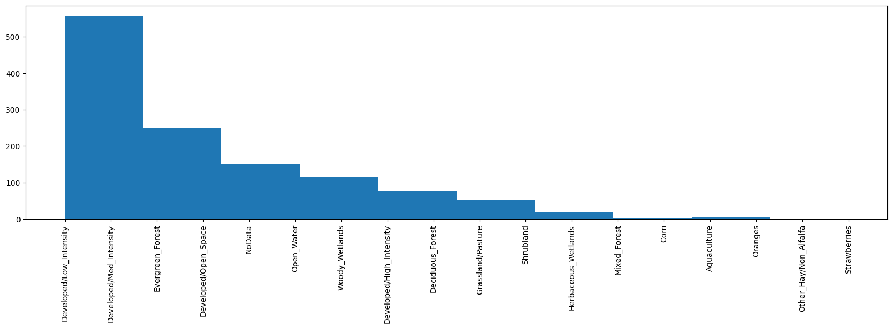

# Insect and Crop overlap

### Objective

This analysis aims to understand the proximity of insects to certain crops. The working assumption is that certain insects are attracted to specific crops, making this an important attribute for the MaxEnt analysis.

### Preliminary Analysis

I will plot a histogram to visualize the frequency of insects and the types of crops in their vicinity using the **2008 crop land data layer**. This is just a pre-check to get a rough estimate of the areas and crops each insect prefers. While ideally, we would generate a separate histogram for each insect from 2008 to 2023, I assume that crop changes over this period are not dramatic—this can be confirmed by visualizing the USDA CropLand data. Therefore, using 2008 data should provide a reasonable approximation.

### Final MaxEnt Analysis

For the full MaxEnt analysis, I will use precise crop data, matching the **exact crop year** with the year when insects were reported. I will create a pipeline to achieve this, ensuring accurate crop-insect associations.

# EDD MAPs Site Folder

### File: Brown_Marmorated_Stink_Bug - (Halyomorpha_halys) (1999_2023).gpkg

### File: Corn_Earworm - (Helicoverpa_Zea) (2004-2023).gpkg

### File: Large_Lady_Beetle - (Harmonia_Axyridis) (1995-2023).gpkg

# GBIF Site Folder

### File: Brown_Marmorated_Stink_Bug -  (Halyomorpha_halys) (2007-2023).gpkg

## File: Root_Weevil - (Diaprepes_abbreviatus) (2012-2023).gpkg

